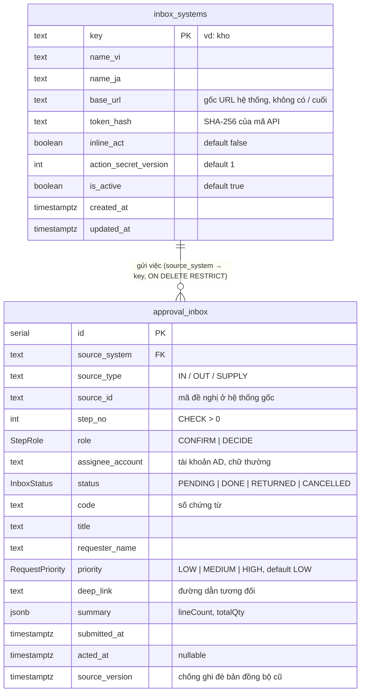

# Sơ đồ ER – Việc cần xử lý (kujiraa-inbox)

Nguồn: [`db/schema.ts`](../db/schema.ts). Database PostgreSQL riêng, Drizzle ORM.
DB chỉ là **bản sao tóm tắt** để hiển thị; dữ liệu nghiệp vụ và việc duyệt thật vẫn ở hệ thống nguồn.

## Sơ đồ

## Enum

| Enum | Giá trị |
|---|---|
| `StepRole` | `CONFIRM` (xác nhận), `DECIDE` (phê duyệt) |
| `RequestPriority` | `LOW`, `MEDIUM`, `HIGH` |
| `InboxStatus` | `PENDING` (chờ), `DONE` (đã xử lý), `RETURNED` (trả lại), `CANCELLED` (hủy/thu hồi ở hệ thống gốc) |

## Index và ràng buộc

| Tên | Bảng | Nội dung |
|---|---|---|
| `approval_inbox_source_step_key` (unique) | `approval_inbox` | `(source_system, source_id, step_no)` – định danh một bước duyệt, đích của upsert |
| `approval_inbox_assignee_status_idx` | `approval_inbox` | `(assignee_account, status, submitted_at, id)` – truy vấn "việc của tôi" |
| `approval_inbox_step_no_positive` (check) | `approval_inbox` | `step_no > 0` |
| FK `source_system → inbox_systems.key` | `approval_inbox` | `ON DELETE RESTRICT` |

## Ghi chú thiết kế

- Không có bảng người dùng: người đăng nhập chỉ thấy dòng có `assignee_account` trùng tài khoản AD của mình.
- `inbox_systems.token_hash` chỉ lưu bản băm; mã API gốc hiện một lần khi tạo/đổi.
- `approval_inbox.source_version`: bản đồng bộ cũ hơn bản đã lưu bị bỏ qua (`stale`).
- Mất bảng `approval_inbox` thì hệ thống nguồn đối soát lại (kho gửi lại mỗi giờ).
